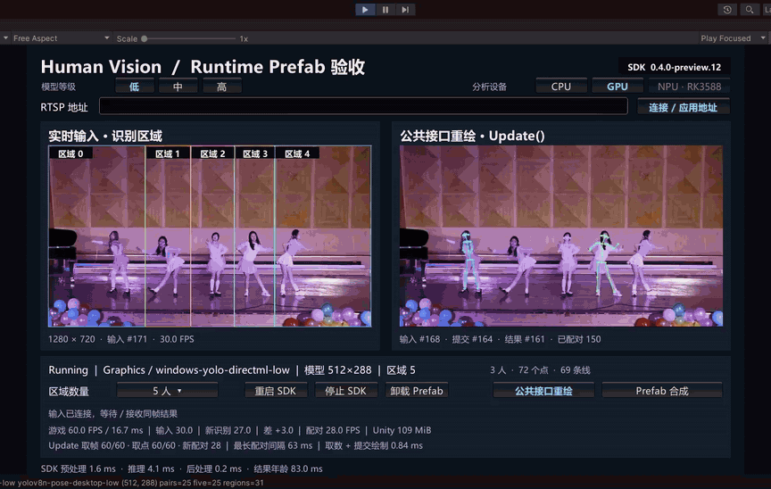
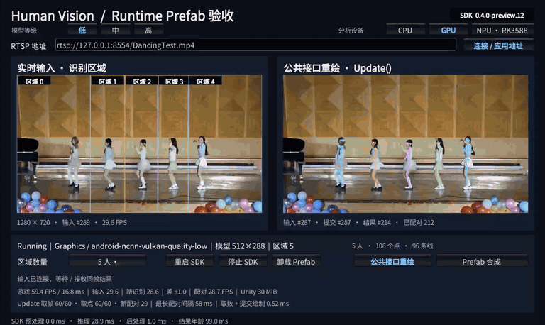

# preview.12 Windows YOLO 与升级验证

Windows CPU 使用 ONNX Runtime CPU，GPU 使用 DirectML。两个后端使用同一套 YOLOv8n-pose 权重。三档的输入尺寸与 Android Vulkan 一致。旧 RTMO 配置供显式调用旧底层 Profile 的项目兼容。

Windows 图结构从随包的 NCNN 参数生成，权重在会话创建时从 SDK 已有的 NCNN 文件读取并验证 SHA-256。发布包没有新增权重副本。DirectML 采用高性能 GPU 偏好，并禁止 CPU 执行提供程序回退。

导入时自动安装 Windows 配置。旧工程已有通过校验的 Android CPU/NPU 资源时，Windows 使用独立索引，Android 索引、阶段凭据和 ARM64 二进制沿用已有版本。离线包先导入自带资源到独立目录，再执行同样的安装规则。

## Unity Editor 旧资源升级测试

Unity 2021.3.45f1。使用跨栏王现有的本地 Android 运行资源，在独立 Unity 工程重新导入 SDK，随后使用本地 DancingTest RTSP 测试 SDK 入口及 Runtime Prefab Acceptance。
旧 Android 资源索引和阶段凭据 SHA-256 均与导入前相同。六种组合均验证了实际模型、计算后端、纹理和按区域取得的骨骼。

| 后端 | 档位 | 模型尺寸 | 同帧配对 | 同时识别五人 |
| --- | --- | --- | ---: | ---: |
| CPU | 低 | 512×288 | 25 | 14 |
| CPU | 中 | 640×384 | 25 | 24 |
| CPU | 高 | 960×576 | 25 | 25 |
| DirectML | 低 | 512×288 | 25 | 8 |
| DirectML | 中 | 640×384 | 25 | 25 |
| DirectML | 高 | 960×576 | 25 | 25 |

每档的五个区域均取得有效关节。上述计数来自每次切换档位后的一段短测，设备稳态帧率需按所选档位另测。

Windows x64 Player 使用同一套 SDK 重测六种组合。每档各检查 25 组同帧配对，六档均覆盖五个区域，每组同时识别到五人。Input-first 离线包也在带原有 Android 索引的工程完成重导入及 DirectML 低档实播，旧索引和阶段凭据的 SHA-256 保持一致。

## Android 真机复测

OnePlus 9 Pro，Android 14，Vulkan，DancingTest RTSP TCP，1280×720 预览，YOLOv8n-pose 低档 512×288。录屏后的 28.26 秒窗口中，输入 29.87 FPS、新识别 28.81 FPS、配对 28.80 FPS。录屏期间配对 27.44 FPS。共检查 1,777 组配对，帧身份不一致为 0，741 组同时识别到五人。

Android CPU 和 RK3588 NPU 的私有部署资源继续通过对应补充包提供。现有有效私有资源可保留。重新执行本地资源启用菜单时使用与本版 Windows DLL 对应的补充包。RK3588 NPU 性能仍待真机验收。

## Android 模型与输入链路

Android GPU 使用 NCNN Vulkan 的 YOLOv8n-pose 低、中、高档。双模式构建可在 GPU 与 RK3588 NPU 间切换，NPU 明确使用 `backend.rknn`、`pipeline.yolo.tensor` 和 512×288 的 YOLOv8n-pose RKNN 模型。启用 Android CPU 时使用 512×288 的 YOLOv8n-pose ONNX。

三条路径共用 Input 的 RTSP 解码和纹理发布。MediaCodec 保留出队顺序并使用 24 ms 最小释放间隔。Vulkan 图像转换等待 Unity 读取上一张纹理和可用槽位，等待期间只保留最新待转换图像。NPU 通过独立纹理快照异步读回，模型尺寸读回通过像素校验后启用，之后提交给 RKNN。构建缺少配套资源、设备不支持或 RKNN 初始化失败时，SDK 会报告原因。

## DancingTest 录屏





## 检查命令

```powershell
py -3.13 tools/package/test_windows_yolo_release.py
py -3.13 tools/package/test_package_release_snapshot.py
py -3.13 tools/package/package_release_snapshot.py --authority tools/package/release-preview12-authority.json --verify-only
```

Windows 原生库构建、桌面几何回归和发布包检查均已执行。完整历史 YOLO 回归仍依赖未随仓库提供的本地黄金数据，缺失数据相关用例无法完成。本轮六档实播与 Android 真机复测使用实际 DancingTest。
