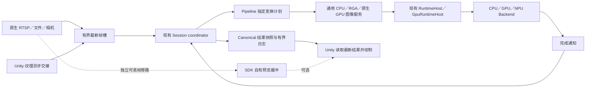

# SDK 独立运行与 CPU／GPU／NPU 通用调度改造设计

日期：2026-11-23。状态：**用户已批准实施，通用基础与原生RTSP候选已实现，硬件验收待进行**。实际完成范围见[验收记录](../../reports/2026-11-23-sdk-independent-runtime-acceptance.md)。

源码基线：`main` / `69be01b92332dbcc9e1cd7ee1cd81d415418cd1b`。实现位于独立工作树，`DEVELOPMENT_STATUS.md` 记录用户批准后的活动范围。原默认兼容路径、模型合同及旧ABI保留；新增控制／图像服务API独立版本化，业务项目未修改。

## 1. 用户目标与设计决定

用户要求 SDK 与 Unity 游戏层分开运行，研究 CPU／GPU／NPU 通用方案，尽量降低游戏渲染对输入及骨骼识别帧率的影响。RK3588 是重点验证平台；根据本轮澄清，先共用相同的异步方案，RGA＋NPU 是后续可选的图像处理优化。用户补充 RTSP、VideoPlayer、WebCamTexture 都可以异步启动和获取图像，要求核查 MediaPipeUnityPlugin 的实现。

本设计的架构选择是：**进程内原生 Runtime 自主运行，Unity 是控制与结果显示的消费者；输入、图像处理、推理后端按能力组合。** 下文保留完整目标；其中尚未验收的来源、图像服务和性能要求不能当作已完成能力。

| 选择 | 收益 | 代价／结论 |
| --- | --- | --- |
| 保留 Unity 输入，异步提交＋原生 worker | 最小接入变化，先改善等待、回调和背压 | 输入纹理交接仍可能依赖 Unity；保留为兼容模式 |
| 原生自主 Runtime＋可替换输入驱动 | 采集到结果发布不要求 Unity 逐帧推进；复用现有 Host | 推荐主方案，需补原生输入与生命周期 |
| 独立进程／Android service | 可进一步隔离进程生命周期和故障 | 增加 IPC、缓冲共享和权限成本；同 GPU 仍竞争，暂不作为第一阶段 |

实施优先级明确为：**先交付CPU／GPU／NPU共用的异步基础和输入交接，再测量各平台瓶颈，最后按需替换图像服务为RGA等专用硬件。** RKNN不需要等待RGA实现才获得独立worker、最新帧背压和主动结果发布。图像服务与推理后端分别选择：NPU推理可以搭配CPU图像处理，也可以搭配原生Vulkan图像准备与异步回读；后者仍使用GPU，必须准确报告。
线程隔离、GPU 队列隔离、物理算力隔离是不同目标。同一 SoC 的 GPU／CPU／NPU 仍可能竞争内存带宽、功耗和散热。此次不引入 GPU 硬分区、实时调度特权或新的动作识别算法。

## 2. 改造前源码基线的实际边界

| 环节 | 当前事实与定位 |
| --- | --- |
| 原生 Host | `runtime/host/runtime_host.cpp:113–154` 已有推理 worker，不能再建重复 Host／推理线程池来表示独立运行 |
| Session | `runtime/composition/session.cpp:301–319` 已有 coordinator，负责输入、区域处理和 body／hand 提交；RKNN 当前保持单推理实例 |
| 完成发布 | `session.cpp:174–214` 的部分语义处理依赖新输入、Copy 或 Stats 时 Poll；最后一帧完成后也必须能主动发布 |
| Unity 送帧 | `upm/com.blazetc.humanvision/Runtime/Demo/Input/HumanVisionInputAdapter.cs:162–170,228–242` 由 Update 驱动 |
| Android RTSP | 硬解输出线程已独立，但 `native/input/src/android/unity_input_vulkan.cpp:415,682–683` 转换仍提交 Unity graphicsQueue |
| Unity 来源 | WebCamSource 检查新帧、VideoSource 使用 frameReady；异步产帧与取图交接是否自主应分别测量 |
| Windows | 原生 RTSP 已可生成 CPU RGBA，当前不必再上传 Unity 纹理后回读才能推理；DirectML 使用自己的原生后端 |
| RK3588 | RGA 仅探测、未启用；RKNN 共享 I/O 仍包含 CPU Pack／memcpy，不等于 decoder→RGA→NPU 直连 |
| 生命周期 | 当前 Session 主要通过 Start／析构管理；LatestFrameSlot::Stop 不可当作可恢复 Pause |
| 元数据 | Host 的 `frame_id % 64` metadata 表不应承担新自主输入的身份所有权；元数据应随 job 的 envelope 固定保存 |

现有 `docs/maintenance/RK3588_RGA_ASSESSMENT.md` 与 0.4 v2 架构增补继续有效。历史 texture-only 设计不被静默替换；新的原生来源是独立可选模式。

## 3. 异步与自主性的定义

不按 RTSP／VideoPlayer／WebCamTexture 的名字判定是否自主，而按实际能力和测量结果判定。

| 级别 | 要求 |
| --- | --- |
| AsyncProcessing | 一帧被安全交接后，推理与完成发布由原生 Runtime 推进，Unity 不等待推理 |
| IndependentInput | 不依赖 Unity Update、coroutine、render event 或 Unity 纹理生产即可持续得到新输入 |
| IndependentPipeline | IndependentInput＋预处理／推理／语义发布均无需 Unity 帧循环；初始化也无需 Unity graphics context |

`async/await`、coroutine、AsyncGPUReadback、异步准备视频都可能有用，但本身不构成 IndependentPipeline 证明。保留异步兼容入口，不能因为底层产帧异步就宣称后续纹理交接完全独立。

三种输入均进入同一 SourceAdapter 协议：

- RTSP：复用原生 demux／MediaCodec／Windows decoder；补齐独立图像输出。
- 本地视频：保留 VideoPlayer 异步兼容入口；独立模式增加原生文件解码驱动，按媒体 PTS 与单调时钟播放，不能以文件解码极限速度假冒实时输入 FPS。音频／Unity VideoClip 资产解包不进入本次首阶段。
- 相机：保留 WebCamTexture 异步兼容入口；独立模式使用平台相机驱动。Android Camera2／NDK 与 Windows Media Foundation 分别实施，权限仍在平台允许的线程处理。不假设 USB 相机必然经 Camera2 暴露，也不同时打开同一相机。

原生相机／文件驱动分阶段交付；未实现时明确报告该组合的能力，不将三类来源同时标记为已独立支持。Unity 创建的 render texture／游戏画面输入继续属于兼容入口。

## 4. 目标线程与组件

- 控制执行器串行处理启动、暂停、换源、配置、停止；Unity 发命令后轮询状态，不等模型／GPU／网络退出。
- 原生 source 已有读流与 decoder 输出线程继续复用。平台回调只转交租约、序号和时间，不执行推理或用户业务。
- coordinator 扩展为“输入、Host 完成、控制命令、取消／截止时间”的事件驱动等待；复用现有 body／hand Host。
- CPU 图像转换在现有可配置 worker 预算内执行；RGA／GPU 提交在各自设备 owner 上执行，不让多个线程无同步访问同一 queue。
- BodyServices 的追踪、区域、canonical 合并由单一 owner 执行；不得从 worker 和 Unity Copy 两边同时修改。
- Unity 主线程只处理配置、权限交互、最新结果复制与 Unity 对象。保留原 ResultUpdated 主线程语义，不把事件悄悄搬到 native 线程。

没有新帧或完成事件时用条件变量／平台等待，禁止无界 while 忙等、按游戏 FPS sleep、每帧创建 Task、默认高优先级抢占游戏。

## 5. 输入租约、背压与身份

新增独立 Input API 表，不修改现有 `HV_InputOptions/FrameInfo` 或 V1 导出。建议文件 `native/input/include/humanvision_input_v2.h`，使用 `struct_size/api_version`；只包含图像、同步和所有权描述，不引用 SDK、模型或 Unity。

内部 `FrameEnvelope` 随租约或 copied job 保存：source_id、generation、frame_id、config_epoch、region_revision、PTS／有效性、clock_id、时间来源、接收／解码／提交时刻、宽高与 crop、逐平面 stride／pixel stride／offset、format／modifier、色彩 matrix／range、旋转镜像、原图到分析图变换、buffer token 与完成条件。不能从裸 fd 猜格式，不能通过 frame_id 查易覆盖旁表补身份。

- 每 session 一种 active ingestion owner；自主源绑定时拒绝旧 Unity adapter 同时提交。
- 每流一个 latest pending 槽；正在执行的帧不可被覆盖。默认 source／分析缓冲池分别 3 槽，初始化时可有界配置，不按帧率增长。
- 优先丢弃尚未处理的旧帧，统计 source／预处理／admission／推理各阶段的丢帧原因。已提交硬件操作只有真正完成后才允许复用。
- fence 完成与 cache 一致性分别处理；等待必须可取消／有截止时间。超时不代表 fence 成功，不能靠 device-idle 或强制回收制造成功。
- 输入库与 Runtime 的单调时钟分别 query／映射；记录 offset 与不确定度，不能把 PTS 或 local decode 当原始传感器时间。未经同帧原始时间验证，不报告 sensor latency。
- Pause、重连、seek、EOF loop、尺寸、方向、配置变更都携带独立 generation／epoch；region_revision 保留原语义，不兼任所有代次。

## 6. CPU／GPU／NPU 共用协议与平台差异

| 路线 | 自主输入到后端 | 隔离与实施边界 |
| --- | --- | --- |
| Windows CPU | 原生 decoder→CPU 像素→现有 tensor pipeline／ORT | 首个可无 Unity 验证的完整基线 |
| Windows GPU | 原生 CPU 像素→现有 DirectML | 可线程独立，仍竞争 GPU；不宣称 Unity texture 零拷贝 |
| Android CPU | 原生图像服务→CPU可读像素→现有CPU后端 | 可读YUV／CPU转换或原生Vulkan异步回读均可；PRIVATE不可直接CPU lock |
| Android GPU | 原生 converter→SDK-owned RGBA AHB→既有 NCNN import | 新原生 producer owner；复用 NCNN 的 device identity、AHB import、sync-fd，不重写推理后端 |
| RK3588 NPU | 原生decoder→通用CPU／Vulkan图像服务→现有RKNN | 与CPU／GPU共用异步调度；RGA可后续替换图像准备以进一步减少GPU占用 |

Host 只按 capabilities 组合。Pipeline／ModelPack 决定尺寸、letterbox、ROI、插值、通道、mean／norm 与逆变换；通用图像服务执行计划；Backend 负责 tensor layout、设备分配与推理。不在 Host 硬编码模型名、512×288、RKNN 类型或某个厂商条件分支。

CPU 设置整个 session 的 worker 预算，统计 ORT／XNNPACK／预处理线程总量，避免每层各占满 CPU。沿用禁 spinning 与顺序执行合同，亲和性／核数调整须实测，不默认实时优先级。

GPU 自主路径必须拥有独立于 Unity 的设备／queue／资源生命周期，不能在普通后台线程直接调用 Unity graphicsQueue、AccessTexture 或 Unity API。逻辑设备与 queue 独立不代表硬件算力隔离；将 GPU 拥塞与 Unity 主线程依赖分别报告。Windows DirectML 同一 session 的 Run 按既有合同串行。

Android通用原生图像服务提供两个有界出口：SDK-owned RGBA AHB供GPU后端直接消费；SDK-owned常规RGBA图像复制到host-visible staging缓冲，供CPU／RKNN消费。后者由SDK自己的Vulkan owner提交与观察copy fence，必要时执行非coherent host memory invalidate后才发布可读lease，不调用Unity AsyncGPUReadback，也不等待Unity Update。PRIVATE图像必须先按真实能力导入并转换为SDK自有的已知格式，不能直接假定其可复制或线性布局。模型尺寸直出仍服从prepared-input扩展及数值gate。

staging目标在CPU／NPU读取结束前不得复用；读回错误／超时不发布有效帧，按既有ErrorRetiring合同退役。该路线是需实现并验证的候选能力，不是当前SDK已有支持。它消除Unity帧循环依赖，仍有GPU计算／带宽竞争和回读成本。[Vulkan图像到buffer复制](https://docs.vulkan.org/refpages/latest/refpages/source/vkCmdCopyImageToBuffer.html)、[同步规则](https://docs.vulkan.org/guide/latest/synchronization.html)提供实现基础，不代表目标设备验收。
### 图像服务与可替换 Pipeline 的扩展协议

新增 `runtime/include/humanvision_image_service_v1.h`：定义来源中立的 `HV_ImageDescriptorV1`、`HV_ImageTransformPlanV1`、`HV_PreparedImageLeaseV1` 和 `HV_ImageServiceApiV1`。表提供QuerySupport、SubmitTransform、WaitTransform、CancelTransform、ReleasePrepared；Wait仅在SDK owner上执行，取消不等于硬件已完成。descriptor携带格式／planes／stride／色彩／同步／buffer owner，不携带模型类型。

新增独立query `HV_QueryPipelineImageExtensionV1`，返回 `HV_PipelineImageExtensionV1`：DescribeTransform从已创建pipeline instance与source descriptor生成通用计划；ProcessPrepared接收准备好的图像租约并输出原canonical观察合同。composition显式注册插件ID到query，动态插件可按新符号发现；不修改旧HV_HostServicesV1或Plugin ABI1／2／3表。

Host worker按能力调用DescribeTransform→图像服务→ProcessPrepared，仍是原Host的同一个job。prepared lease保存plan fingerprint、ModelPack／profile契约摘要、source identity与逆变换；pipeline必须拒绝过期或不匹配的prepared输入，并保证letterbox、mask、通道和mean／norm只执行一次。设备tensor分配／绑定仍属backend；共享设备内存另经版本化后端能力扩展，不往旧tensor view塞vendor指针。

无扩展的旧pipeline走原HV_VideoFrame process：若可由原生图像服务生成合法CPU图像则兼容转换，否则明确不支持。A1允许RGA只做源CSC／方向处理、由旧pipeline完成模型缩放，先验收自主性；RGA模型尺寸直出必须在新扩展及数值gate通过后启用，不能直接跳过旧PreprocessLetterbox。

## 7. RK3588 可选 RGA＋NPU 进一步优化

### A. 在通用异步方案上替换图像服务

RGA不是CPU／GPU／NPU异步基础或RKNN自主供帧的前置条件。以下A1／A2只描述RGA这一可选图像服务的两个优化等级，不能解释成NPU从零开始另建运行系统。

A1：MediaCodec source lease→平台 RGA importer→可重用 RGB 图像→现有 tensor pipeline／RKNN。允许有界 CPU copy，记录复制量；关键验收是无 Unity texture、Blit 或 AsyncGPUReadback 也持续运行。

A2：在 A1 正确性通过后，验证 RGA 写 RKNN 分配的兼容内存，或双方可导入的明确分配 dma-buf；按真实 `size_with_stride/w_stride` 绑定。保留 A1 基线，新增路线必须同帧质量不退化且有净收益才晋级。

“零 CPU 像素搬运”不等于内存零读写。RGA 仍读源写目标，RKNN 也可能执行输入转换；native FP16、pass_through 和量化不随线程改造自动开启。

### B. 必须通过的能力门槛

1. 普通目标应用身份加载匹配 BSP／gralloc 的 librga 与依赖成功；记录 Android、driver／runtime、库／模型哈希和应用声明。官方 AHB importer 含平台条件，纯 NDK 制品存在不等于可调用。
2. 对真实 MediaCodec PRIVATE AHB 的 importer、layout／modifier、stride、crop、matrix／range 可验证；PRIVATE 不能当紧密 NV12。
3. decoder acquire、RGA release、NPU 完成、cache sync、取消／错误退出都正确，目标在 NPU 完成前不得重用。
4. RGB／tensor 与冻结 oracle、真实模型输出、多人跟踪、区域 mask 逐项验收。RGA CSC／插值不假定字节相同；误差阈值先冻结，不能测试失败后放宽。
5. 不改变模型档位／画质／人数做同机 A/B，并完成热机持续测试，才允许进入默认选择。

### C. 能力不满足时

RGA不可用时，优先使用已经通过能力验证的通用原生Vulkan转换＋异步staging回读，或可读YUV planes→通用CPU转换→CPU／NPU，仍可自主。这些候选能力均须实施验证，不因RGA缺失就将整个NPU方案判为不支持。软件解码可作为显式可选 fallback，但须报告 CPU 成本，不能称为性能提升。

若只有旧 Unity Vulkan 路径可用，兼容模式可继续使用并明确原因；**IndependentRequired 模式直接报告不支持，不能静默退回 Unity 驱动并宣称自主**。Auto 也不得改变用户禁止 fallback 的既有选择。

## 8. 结果发布与 Unity 读取

Host 完成记录唤醒 coordinator，最后一帧即使没有后续输入、没有 Copy／Stats 调用，也要执行语义合并并发布。内部固定容量完成记录至少覆盖所有已接纳 in-flight jobs；完成积压时限制新的 SDK job 接纳，不等待 Unity、不覆盖尚未完成语义处理的记录。

对外提供两个消费者视图：

- 最新 coherent snapshot：Unity 用 caller-owned 数组复制；其停顿不持有 native result 槽。保留原 `HV_RuntimeCopy(sample_timestamp_us)` 的采样语义，采样／预测不增加 fresh 计数。
- 有界 canonical observation journal：原生诊断／消费者用独立 cursor 读取；默认容量 64 条，慢读者明确收到 overrun／lost_count，不反压推理。body／hand completion kind 与 sequence 分开，不能将手更新算作新人体结果。

观察历史属于 Runtime，Unity annotation／preview 只是消费。主线程卡住时游戏画面与 ResultUpdated 不可能继续更新，但 native 新结果与统计仍应推进；恢复后读取最新结果，日志消费者可按容量恢复历史。不在此次扩展中引入业务动作识别。

## 9. 预览和精确同帧图像不得反压识别

提供 NoPreview、LivePreviewBestEffort、ExactSnapshotOnDemand 三种可组合策略，保持 SDK 现有同帧 API 与身份约束。

- 预览使用独立 SDK-owned pool（默认 3 槽），满则跳过预览，不占用分析槽。
- 自主模式不得把 decoder AImage 的释放或分析缓冲归还绑定到 Unity 下一帧／render retirement pump。不能因为 Unity 长时间不消费预览而耗尽 ImageReader。
- 需要原色预览时，由原生图像服务生成独立 owned copy 后释放 source；生成策略有预算，不为了追逐高清预览延迟分析。若该平台仅可借用 decoder buffer 给 Unity，则不宣称具备此自主预览能力。
- 精确同帧拍照最多一个 pending 请求、独立 pool、可取消与超时；只接受 source／generation／frame／transform 完全匹配的原图，缺失则返回不可用，不用当前画面冒充。
- 预览纹理的 Unity 导入／销毁仍在合法线程并等真实完成条件。可关闭预览验证独立性，也须验证预览打开后不会反压；不能只测无预览就宣布完整业务路径达标。

预览准入规则固定为：分析优先；native preview copy最多1个在途；在保留source之前先检查preview目标槽与copy额度，并保留至少2个source credits供分析／decoder推进。可用source credits不足3时，不允许预览另外持decoder lease，改从已独立owned的图像复制或报告自主预览不可用。Unity consumer不能持有此source credit。

若分析与preview共用RGA／GPU图像服务，先提交分析，分析有pending时不追加preview；一次preview的尺寸／估计copy时间须满足设备profile中实测冻结的预算。超过预算即停发后续preview并记录；不能靠增加source槽掩盖拥塞。此规则限制资源占用和干扰，不保证同一引擎零竞争。阻塞在Unity GPU队列的预览不得持decoder／分析租约；设备本身的queue失效进入下述ErrorRetiring，不伪称硬件挂起时识别仍正常。

验收额外延迟preview copy的实际完成，而不只是延迟Unity取图；证明预览最多占其1个额度、至少2个source credits仍可推进。共享图像引擎压力单独测延迟与skip，禁止将设备挂死当普通慢消费者通过。

## 10. 生命周期与兼容

新控制执行器维护 Created／Starting／Running／Pausing／Paused／Reconfiguring／Reconnecting／Stopping／Stopped／Error／ErrorRetiring；使用新查询结构，不修改旧状态 enum。

Pause 关闭 admission、清 pending、失效 epoch，等待硬件租约在 owner 上退役后报告 Paused；Resume 使用新 epoch，重置跨暂停历史。应用真正进入后台时默认有序暂停，进程被系统挂起不属于持续运行保证。

Reconfigure 先验证配置，再串行 quiesce／重建；不为无缝切换临时创建第二套 RKNN context。失败可回到 Error 或显式重建旧配置，不能承诺零停顿回滚。

Stop 先禁止新帧、唤醒／取消输入，再处理真实 in-flight 完成、失效晚结果、停止 Host 与 coordinator，最后释放 source／模型／设备。任何等待都不持有 worker 发布需要的 mutex。原生停止不得依赖 Unity 继续渲染；Unity 自有资源另按 engine 生命周期退役。

超时终态：控制请求截止时可返回Timeout，但未完成的硬件操作继续由原owner持有，进入ErrorRetiring／关闭待退役状态；不复用buffer、不销毁context、不卸载依赖库，也不建立冲突RKNN context。owner以有界等待继续观察实际完成；真实完成后才能转Stopped并允许TryRelease。若驱动调用永久不返回，handle保持不可释放，业务收到需重启进程的明确错误；进程结束由操作系统回收，不能以强杀线程、伪造fence或提前dlclose处理。此异常下不承诺同进程无停顿卸载。正常应用退出／Editor reload另有生命周期gate。
新路径使用独立 opaque `HV_RuntimeControllerHandle`，不借用或暴露其内部一次性Session指针。`CreateDeferred` 仅校验／复制有界配置并建立控制对象，不加载模型或打开设备；`RequestStart` 在control owner执行重操作。`RequestClose` 非阻塞停止并请求最终退役，`TryRelease` 只有在所有native owner线程与真实资源均退役后返回OK，否则BUSY且handle继续有效。不得在Unity主线程join尚未退出的线程。旧HV_RuntimeCreate／Destroy的同步合同保留，Unity新模式内部改用新表；新表提供与旧Copy等价的coherent读取，不允许把controller handle传给旧C函数。

创建期间取消、初始化失败、启动中close、stop超时、repeat close、release与callback并发都必须测试。调用方串行最终TryRelease；成功之后禁止再调用。
旧 V1 C ABI、语义 ConfigV1／StatsV1／Submit／Copy、Plugin ABI1／2／3、Unity 事件线程语义均保持。新增控制、source 绑定、StatsV3、journal 采用新表／新结构；内部 leased-frame／image-service 扩展不得往既有 ABI struct 末尾直接添字段。

新策略名称是建议 API：`CompatibleUnityInput`、`IndependentPreferred`、`IndependentRequired`。actual source／preprocessor／backend、fallback reason、自主能力等级必须可查询；不暴露模型张量或厂商结构到 Unity 游戏 API。

## 11. MediaPipeUnityPlugin 实现核查

独立研究见 [MediaPipeUnityPlugin 异步与线程分析](../../reports/2026-11-23-mediapipe-async-runtime-analysis.md)。核查固定源码版本，不将旧 Solution API 与新 Tasks API 混为一谈。

采纳其按输入／处理／结果显示分层、异步结果监听、有界纹理池、按支持能力选择 GPU image 或 CPU readback 的思路；是否替换输入驱动由自主性验收决定，不预设必须更换全部 Unity 输入。

本方案不引入 MediaPipe 依赖、不更换现有识别模型或后端。对其机制与现有 SDK 已有机制的重合和差异，在独立报告中逐项记录。

## 12. 验收矩阵与指标

以下是本提案建议的工程门槛，尚未实测。现有 1–8 人、真实手部点和逐人完整骨骼 30 FPS 产品目标不降低；线程独立通过不等于模型质量／完整骨骼目标通过。

| 检查 | 测法与期望 |
| --- | --- |
| 无 Unity | native harness 单独运行 source→完整处理→canonical publish；不加载 Unity graphics context |
| Unity 不消费 | 正常前台，禁 SDK Update／结果读取／预览消费；native 新输入与新结果持续前进 |
| 主线程停顿 | 前台注入 500 ms、2000 ms 主线程停顿，不使用 Time.timeScale=0 代替；用 native 计数／日志测连续性 |
| 控制对照 | 游戏限帧 15／30／60；识别请求保持不变，分开测无额外负载限帧与真实 CPU／GPU 压力 |
| 后端矩阵 | Windows CPU／DirectML，Android CPU／NCNN／RKNN先使用通用图像服务验证；RGA＋RKNN另作同机优化对照。缺能力项记unsupported／needs-device，不算通过 |
| 来源矩阵 | RTSP、本地文件、相机；独立驱动与 Unity 兼容入口分别标记能力和结果 |
| 完成驱动 | 只送最后一帧、不再 submit／Copy／Stats，仍发布新的 canonical sequence |
| 资源压力 | 慢／不读预览、慢日志读者、满池、长推理、超过64个frame间隔、换源／seek／重连／方向变化 |
| 生命周期 | 循环100次启动／暂停／恢复／换源／停止，资源无增长；设备失败不将未完成 fence 标记成功 |
| 画质与骨骼 | 同帧像素／tensor／完整输出、region mask、原图坐标、跟踪与已声明手部质量不回退 |

建议先做5分钟预热、再做30分钟持续窗口并记录最慢10秒窗口。轻量对照中，native fresh FPS 对比无 Unity 基线下降不超过5%、age p95 增量不超过20 ms，作为“线程解耦”初始门槛；固定负载矩阵均记录退化，不承诺满载／热限频时零影响。最终性能SLA由目标板同机数据确认。

记录 decoded_fps、unique_input_fps、preprocess_completed_fps、admitted_fps、native_fresh_body_fps、各人完整关节FPS、hand_fresh_fps、Unity delivery_fps／render_fps、result age p50／p95／max、各阶段耗时、等待原因、copy bytes、队列／池占用与各类drop，以及温度／频率／功耗条件。重复读取、插值和显示FPS不能算推理FPS。诊断聚合后低频导出，不加逐帧JSON热路径。

## 13. 实施顺序、退路与交付

1. 基线／可观测性、FrameEnvelope 与完成驱动语义发布。
2. 显式生命周期与新控制接口；Windows native RTSP＋CPU 首个无 Unity 闭环。
3. Unity 薄适配器与现有三类输入的异步兼容优化；回归原 API 与预览。
4. 来源中立Android原生图像服务的AHB／staging双出口，接CPU、NCNN、RKNN；Windows DirectML对照，共用自主调度。
5. 按瓶颈选择RK3588 RGA能力gate与A1／A2优化；不阻塞前一阶段CPU／GPU／NPU交付。
6. 原生本地视频与平台相机 driver 分开交付；联合游戏负载、热机和发布门禁。

各路径独立开关，旧稳定路径可选；新增包默认值在证据齐备前不切换。SDK/Input 必须作为兼容的一组候选发布，新增依赖沿用现有公共／本地资源边界。计划细目见 [实施计划](../plans/2026-11-23-sdk-independent-runtime-plan.md)。

## 14. 官方资料与待设备确认项

- [0.4 架构增补](../../plans/040-v2/SDK_040_PLUGIN_ARCHITECTURE_ADDENDUM.md)、[RGA 既有评估](../../maintenance/RK3588_RGA_ASSESSMENT.md)。
- [Rockchip RGA 指南](https://github.com/airockchip/librga/blob/main/docs/Rockchip_Developer_Guide_RGA_EN.md)、[平台扩展头](https://github.com/airockchip/librga/blob/main/include/im2d_expand.h)、[RGA FAQ](https://github.com/airockchip/librga/blob/main/docs/Rockchip_FAQ_RGA_EN.md)。官方接口证明候选能力，不证明本板可用。
- [RKNN 内存示例](https://github.com/airockchip/rknn-toolkit2/blob/master/rknpu2/examples/rknn_api_demo/src/rknn_create_mem_demo.cpp)、[RKNN Android API](https://github.com/airockchip/rknn-toolkit2/blob/master/rknpu2/runtime/Android/librknn_api/include/rknn_api.h)。实现继续使用项目锁定版本，不能直接假设最新头接口可用。
- [Android AHardwareBuffer](https://developer.android.com/ndk/reference/group/a-hardware-buffer)、[ImageReader](https://developer.android.com/reference/android/media/ImageReader)、[厂商 native library 声明](https://developer.android.com/guide/topics/manifest/uses-native-library-element)。
- [Unity 原生渲染插件线程](https://docs.unity3d.com/2021.3/Documentation/Manual/NativePluginInterface.html)、[Vulkan queues](https://docs.vulkan.org/guide/latest/queues.html)、[ORT DirectML](https://onnxruntime.ai/docs/execution-providers/DirectML-ExecutionProvider.html)。

本轮未探测设备或运行硬件实验。RGA 的 BSP 接口可见性、真实 PRIVATE import、相机暴露方式、RKNN memory import、正 fence、Mali driver、持续温升吞吐均是后续 gate，不阻止先完成跨平台调度与自动化合同测试。

## 2026-11-23 真机测试后的实时纹理纠正合同

用户在一加测试中明确要求：实时预览及Unity取得的Texture持续跟随源画面；推理迟到只影响骨骼结果；模型档位不能成为把推理接纳帧率称作源输入帧率的理由。本节覆盖此前将5Hz高清CPU复制通道作为Android独立模式实时预览的设计。禁止把降到1Hz的恢复策略当作该目标完成。

实测旧APK `6e440ebe…` 中，CPU高清预览触发预算后永久停在frame727，而原生识别继续。中档原始codec输出与AImage取得约29.95FPS，原“输入FPS”约14–17实际为worker Claim／Unity观察；这两个问题均已确认。该APK已安装，仅属于发现缺陷的候选，不能记为最终验收通过。

修正范围：同一原生decoder后，live与analysis各自有界三槽／latest publication；live尺寸来自输入预览请求，与模型尺寸无关。Unity实时Texture通过native live AHB、Unity render-thread GPU bridge和真实fence交接，不走5Hz RequestCapture，不额外打开decoder，也不与推理抢一次性analysis Acquire。持旧帧与慢Unity消费者最多丢live帧，不反压analysis或decoder。精确抓拍仍使用独立请求／deadline／CPU快照合同。

新Input live API和RuntimeControl增量尾接口保留旧NativeV1、旧21函数前缀和StatsV3布局。live供图及源统计取真实source状态，不以canonical结果、fresh或claim>0作为门槛。source/generation共享源身份，model config_epoch与source generation分开；旧代迟到结果／纹理不得重新发布。单源模型切档的owner保活另做生命周期验收，不能以稳态live通过代替切档零中断。

Demo统计拆为：源解码（原生累计decode counter差值）、Texture实际可见更新、推理接纳（累计native ingress/claim差值）、识别完成（累计native fresh差值）、有效骨骼交付。旧InputPublicationFps继续是主线程观察值，明确命名；缺测显示未知，不用帧号跳数或标称30补值。

验收必须包含：CPU低/GPU低中高同源短窗口的decoder/live/texture/claim/result五段数据；慢/无识别结果仍有live；Unity15FPS及主线程停2秒时源/原生live/分析继续，恢复取最新而非积压；持有旧纹理不覆盖；关live仍分析；换源/重连/停止/关闭及GPU真实退休；颜色、方向和实际预览尺寸。实际设备结果前，不宣称实时问题已修复。

## 2026-11-23 用户确认的业务接入与单预览

验收Demo同时作为普通业务接入样例。每次Update直接调用现有SDK关节坐标查询，更新池化点线；不在样例中追加FPS、FrameId、ResultSequence、分析Texture或RuntimeProgress前置条件。SDK内部统一处理来源、代次、置信度和时效。重复读取仍有效的同一份结果是允许的；没有有效点就清除对应几何。精确同帧拍照和统计去重保留在各自功能中。

界面左侧集中放选项、按钮和诊断日志，右侧只保留一个实时Texture预览，叠加识别区域框、编号及Update取出的骨骼。全屏复用同一绘制路径；保留后端／模型切换、基础配置、人数、骨骼开关、生命周期、拍照及诊断入口。最新Texture与最近有效骨骼允许时间差，不再展示两张内容相同的视频。

实现限定为样例、私有验收工程的安全补丁与接入文档；不修改稳定SDK／C ABI、模型或native调度。先以真实旧样例验证合同失败，再跑简化Update的来源／失效／无纹理／单预览回归，最后在Unity和当前OnePlus安装新候选复核。性能与硬件限制见[后续设备报告](../../reports/2026-11-23-android-realtime-live-acceptance.md)。

## 2026-11-24 原图 Texture 合同补漏

用户再次明确普通Unity RTSP颜色Texture必须保持当前实际码流的解码后可见原尺寸。本节覆盖此前“live尺寸来自预览请求上限”的约定：不能将模型512×288输入、默认1280×720或硬编码1920上限的图像放大后称作原图。只在SDK内部为模型生成小图；明确Analysis接口保留其专门语义。

SDK普通RTSP兼容和独立路径均保持用户URL，普通颜色输出采用0/0=可见源尺寸的新语义。Windows原生SourceBinding按真实首帧／尺寸变化配置缓冲及预览，不再用模型尺寸限制decoder。Android独立analysis维持正模型传输尺寸，live使用0/0；兼容Android同会话从真实SPS／codec元数据取得decoder hint，禁止用1×1代替未知尺寸。正尺寸低层请求保留既有显式上限语义，部分零值拒绝。旧C ABI字段布局与V1不变。

可见尺寸来自decoder crop，不等于AHB编码对齐分配高度（1080p缓冲可能高1088）。当前每轴4096／有界内存与实际GPU能力是明确门槛，超过能力或分配失败必须报原图不可用，不静默缩图。独立可选live失败保留健康analysis；兼容路径极端分配失败保留原输入失败语义，不扩建新的legacy状态机。

验收检查低／中／高模型切换后普通颜色Texture尺寸仍等于相同源可见尺寸，原生输入／完成／Unity观察计数分开；先跑0/0、部分零值、正上限、4K、首帧尺寸／换代／旧lease回归，再使用配套新库冷加载Unity和当前手机验证1080p原图、点线和左右布局。4K自动化不替代4K摄像机与硬件持续性能验收。
