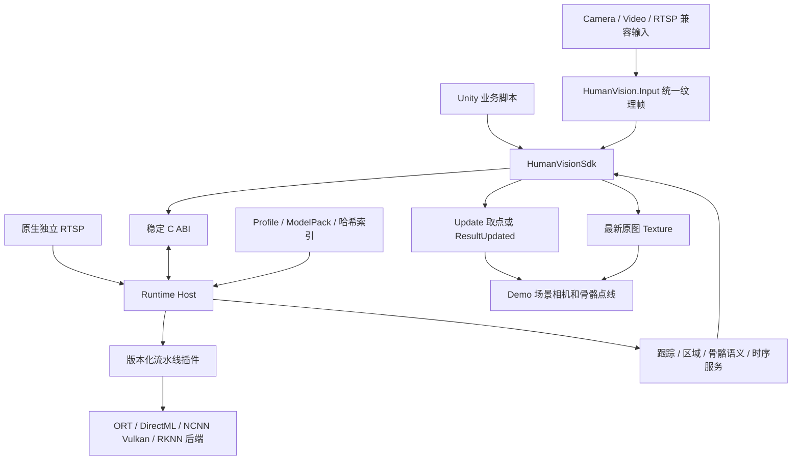

# 技术栈文档

适用 SDK **0.4.1** / Input **0.1.1**，面向 Unity 项目接入。[文档首页](README.md)

## 1. 整体分层

兼容输入由 Unity 采集，独立模式由原生线程启动 RTSP，推进采集、分析和结果发布。Unity 主线程读取最新图像和语义关节。普通预览持续使用最新 Texture，精确配对仅在需要同帧照片或逐帧叠画时启用。[原生独立执行配置](SDK_CONFIGURATION.md#原生独立运行) · [验收场景](UNITY_RUNTIME_PREFAB.md)

## 2. 技术与职责

| 层 | 技术/模块 | 负责什么 | 源码/文档入口 |
| --- | --- | --- | --- |
| Unity宿主 | Unity2021.3+、C#、MonoBehaviour、协程 | 场景生命周期、主线程组件与UI更新 | [初始化与调用代码](FIRST_INSTALL.md#3-void-start中写什么) |
| 图像输入 | `HumanVision.Input`；WebCamTexture、VideoPlayer、原生RTSP输入 | 权限、采集/解码、定向纹理、源身份、帧元数据 | [Input Runtime](../../upm/com.blazetc.humanvision.input/Runtime) |
| 图像展示 | UGUI Canvas、RawImage、AspectRatioFitter、FramePreview | 实际图像与宽高比；输入预览不需要模型 | [FramePreview](../../upm/com.blazetc.humanvision.input/Runtime/FramePreview.cs) |
| SDK Unity接口 | `HumanVision.Runtime` | 运行资源准备、配置、Manager、身体/关节、P/Invoke | [SDK Runtime](../../upm/com.blazetc.humanvision/Runtime) |
| 提交与示例层 | `HumanVision.Demo` | 输入适配、兼容路径 CPU 读回/GPU 提交、Runtime Prefab | [Demo Runtime](../../upm/com.blazetc.humanvision/Runtime/Demo) |
| 原生核心 | C++17、C ABI、Runtime Host | 有界异步任务、插件装配、公共服务与数据复制 | [Runtime](../../runtime)、[公开头文件](../../native/include/humanvision) |
| Windows 执行 | ONNX Runtime CPU / DirectML | 执行桌面 YOLOv8n-pose | `windows-yolo-cpu-*` / `windows-yolo-directml-*` |
| Android执行 | ncnn、Vulkan、AHardwareBuffer、GPU fence | ARM64纹理复制与GPU模型执行；能力/合同不符会报错 | `android-ncnn-vulkan`质量族 |
| 运行组合 | Profile、ModelPack、质量目录、SHA-256索引 | 选插件/模型/实际尺寸/能力，并校验完整性 | [ModelPack指南](../maintenance/MODEL_PACK_GUIDE.md) |
| 示例配置 | JsonUtility、JSON、临时文件及备份 | 共享识别参数和各模式独立输入参数 | [设置API](API_REFERENCE.md#8-sdk设置质量和实际合同api) |
| SDK验证 | Unity Test Framework/NUnit、CTest、Python架构/打包检查 | 托管接口、原生ABI、功能、合同、导入和资产闭包 | [平台与测试边界](PLATFORM_TEST_RESULTS.md) |

入门脚本只依赖Runtime、Demo、Input和UnityEngine.UI。SDK不要求安装UniTask、Cinemachine、Localization或其他业务框架。若自己的脚本放入asmdef，显式引用`HumanVision.Runtime`、`HumanVision.Demo`、`HumanVision.Input`、`UnityEngine.UI`；放在普通Assets/Scripts时使用默认程序集即可。

## 3. 包、版本与平台组合

| 项目 | 当前版本/作用 | 接入规则 |
| --- | --- | --- |
| Input 包 | `com.blazetc.humanvision.input`，`0.1.1` | 先安装，提供图像采集与预览 |
| SDK 包 | `com.blazetc.humanvision`，`0.4.1` | 后安装，依赖 Input |
| Git 标签 | `v0.4.1` | 两包使用同一标签，固定源码提交 |
| Windows原生资产 | x64 DLL及依赖 | 构建x86_64，保留依赖 |
| Android原生资产 | ARM64 SO和桥 | API26+、IL2CPP、ARM64、所选Vulkan路线 |
| RuntimeData | profiles/modelpacks/models/quality catalog/index | 编辑器安装到StreamingAssets；运行Prepare后使用回调路径 |

公开包覆盖 Windows CPU/DirectML 和 Android NCNN Vulkan。Android CPU 和 RK3588 NPU 使用匹配的本地 SDK 与资源。设备及性能验收以实际测试路线为准。[本地资源部署](LOCAL_ANDROID_CPU_YOLO.md) · [平台验证](PLATFORM_TEST_RESULTS.md)

## 4. 采集尺寸、模型尺寸与骨骼语义

| 路线 | 实际身体模型输入 | Profile |
| --- | --- | --- |
| Windows CPU | 低 512×288 / 中 640×384 / 高 960×576 | `windows-yolo-cpu-{low,medium,high}` |
| Windows DirectML | 低 512×288 / 中 640×384 / 高 960×576 | `windows-yolo-directml-{low,medium,high}` |
| Android Low | 512×288 | `android-ncnn-vulkan-quality-low` |
| Android Medium | 640×384 | `android-ncnn-vulkan` |
| Android High | 960×576 | `android-ncnn-vulkan-quality-high` |

相机`RequestedWidth/Height/FPS`是设备采集请求，实际尺寸来自源纹理；模型尺寸来自已验证运行合同，不能用修改请求分辨率或任意JSON尺寸代替更换模型。

Windows 当前使用 YOLOv8n-pose。旧 `windows-pc-cpu` 和 `windows-pc-directml` 属于历史 RTMO 配置。公共 API 返回身体和语义关节。32 个槽位包含派生点，低层查询应查看 `Valid`、`Confidence`、`IsDerived` 和观察时间。当前随包配置关闭真实手任务。世界坐标是图像到 Unity 平面的映射。

Android NCNN 的部分兼容 GPU 提交路径要求定向后的输入为横向 16:9。普通 RTSP 颜色接口保持实际可见原尺寸，具体的识别输入由所选路径和模型合同决定。查看输入错误与 `PreviewError` 可区分失败环节。

## 5. 新项目的调用顺序

| 步骤 | SDK调用 | 含义 |
| --- | --- | --- |
| 安装资源 | 编辑器Install Packaged Models | 把索引与完整运行数据带入项目 |
| 初始化输入 | `InitializeFromPreset(configuration, kind, address)` | 准备资源、创建会话并按配置打开输入 |
| 控制 | `StartSdk()`、`RestartSdk()` | 显式启动或应用配置后重建，检查状态和错误 |
| 读有效关节 | `TryGetJointNormalizedPosition` 等 | 在 `Update` 直接取数据 |
| 读新观察 | `ResultUpdated` | 业务按新观测处理时订阅 |
| 显示 | `GetColorImageTex()` 与有效关节 | 最新原图和骨骼独立消费 |
| 停止 | `yield return sdk.StopSdk()` | 等待会话及输入退休 |

初始化、模型加载、Shutdown和改变容量属于控制操作，可能耗时；CPU SubmitFrame或GPU提交是异步受理，不能据返回true断言完成推理。最新未处理帧可被覆盖，避免积累旧帧延迟。

## 6. 数据、线程与资源约定

- Unity组件/API在主线程使用，推理工作由原生Runtime调度；应用不用另开线程操作Bodies或UI。
- `StableTrackId`、`RegionIndex`、`Bodies[i]`分别代表身份、区域、快照数组位置。不要以数组下标固定绑定玩家。
- `Bodies`是原始观察；`SampledBodies`是显示采样。重复采样同一结果不增加识别FPS。
- 身体/关节对象反复复用；在回调中读取，历史记录复制值，避免保存引用后数据被下次轮询改变。
- 图像左上为原点、Y向下，镜像/旋转由Input定向处理；不要重复反转。把图像点映射到UI时处理宽高比与坐标原点。
- 输入单调时钟、Unity/原生时钟、媒体PTS用途不同；仅在同一或已经映射的时钟域内计算年龄。
- 区域用于当前推理后的结果分配；修改时递增revision，不把区域框当像素遮罩或已证明的性能优化。
- GPU复制完成的fence不表示推理完成。切源/卸载前等待退休，不能提前释放被复制使用的纹理。
- 消费层需处理结果超时、无身体、点无效、遮挡、ID改变和输入停止。SDK骨骼API不会自动替应用定义跑步/跳跃规则。

## 7. 扩展与维护入口

| 需要做什么 | 先看哪里 |
| --- | --- |
| 自己的UI或交互 | [入门示例](FIRST_INSTALL.md)、[API](API_REFERENCE.md) |
| 新输入源 | Input接口、帧身份/时钟、SourceCopyLease与生命周期 |
| 新ModelPack/Profile | [模型包指南](../maintenance/MODEL_PACK_GUIDE.md)，能力声明和哈希索引 |
| 新pipeline/backend | [维护入口](../maintenance/START_HERE.md)，版本化Plugin ABI和独立测试 |
| SDK源码构建/发布 | [发布指南](../maintenance/RELEASE_GUIDE.md) |

安装用户不需要改原生源码。开发时不要直接改Library/PackageCache；需要维护SDK时先按START_HERE中的架构和文档合同定位对应模块。
