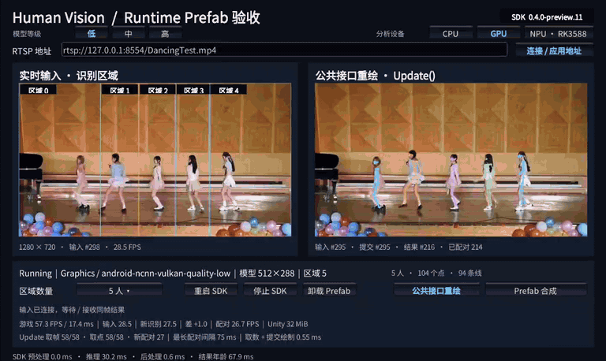

# Preview.11 启动配置、示例与 Android 输入验证

SDK 0.4.0-preview.11 / Input 0.1.0-preview.6。启动优先级为显式参数、场景资产、项目默认资产、内嵌参数。
项目默认资产由 HumanVision → Create Default SDK Configuration 创建。Runtime Prefab Acceptance 是可选导入的 Package Manager Sample，场景保留实时图像、按区域 index 取骨骼及同帧重绘。
「区域数量」下拉框支持 1–8 人。更改人数会为当前会话重建等宽区域。

Android RTSP 在 GPU 和 RK3588 NPU 上共用解码、图像转换与发布。MediaCodec 按输出顺序释放，间隔至少 24 ms。
转换器等待 Unity 观察已完成纹理及输出槽可用，等待期间保留最新待转换图像。RKNN 仍使用既有读回与推理通道。

## 验证口径

- Unity 2021.3.45f1。启动预设 EditMode 14/14，通过 Package Manager 实际导入两个可选样例。另通过 Input-first 离线安装核对项目默认资产、空区域与按区域取点。
- Android ARM64/API 26 输入插件编译通过，帧槽和独立输出调度测试 9/9，40 个 Android Input C 导出一致。
- OnePlus 9 Pro Android 14，IL2CPP、Vulkan、1280×720 图像，YOLOv8n-pose 低档 512×288。用本地 RTSP TCP 播放 DancingTest。帧身份先在 Prefab 发布时核对，再在游戏 Update 核对同一份已发布纹理和区域数据。

| 素材 | 配置人数 | 输入 FPS | 新识别 FPS | 配对 FPS | 录屏期间配对 FPS | 核对配对 | 错帧 |
| --- | ---: | ---: | ---: | ---: | ---: | ---: | ---: |
| DancingTest | 5 | 29.82 | 28.65 | 28.67 | 26.49 | 1,748 | 0 |

常规帧率取录屏结束后 28.32 秒的稳定窗口。采样热状态为 0，纹理槽丢弃计数为 0。DancingTest 按站位设置五个区域，五个区域均命中，共有 730 组同帧配对同时识别到五人。APK 安装后回读 SHA-256 与本地构建一致，包内 Android Input 二进制与发布包一致。

私有 RK3588 补充包重新绑定了本次 Input SHA-256，模型和驱动字节沿用既有本地版本。已构建包含 RKNN 的双模式本地 APK。RK3588 设备的识别效率及驱动表现留给硬件验收。

## 20 秒录屏

公开验收素材为 DancingTest。GIF 由 Android 真机录屏转换，画面中的 SDK 版本为 0.4.0-preview.11，GIF 播放帧率为 8 FPS。上表以运行时计数计算，视频节奏复查使用原始 MP4。

按画面匹配源文件，DancingTest 原始录屏的 282 次可比较画面更新中有 1 次单帧回跳。抓取 H.264 码流后匹配图像片段，180 个可比 RTP 包的时间戳随发送顺序递增，而对应源文件的显示时间出现 87 次逆序。用相同手机和同一输入二进制播放去掉 B 帧的同内容对照，333 次可比较画面更新中观察到 0 次回跳，录屏期间配对 29.07 FPS。对照结果指向本地 RTSP 推流的时间戳与素材的 B 帧结构。下方 GIF 保留原始素材的测试结果。



## 复现命令

```powershell
ctest --test-dir out/android-input-release/host-v180 -C Release -R 'input.(OutputPump|FrameRing)' --output-on-failure
py -3.13 tools/package/test_package_release_snapshot.py
py -3.13 tools/maintenance/check_architecture_boundaries.py
py -3.13 tools/maintenance/generate_component_catalog.py --check
py -3.13 tools/test/verify_upm_git_newlines.py
py -3.13 tools/package/package_release_snapshot.py --authority tools/package/release-preview11-authority.json --verify-only
```

公共附件沿用评估资格和分发边界。GitHub Release 提供八个标准附件和 DancingTest 验证 GIF。原始 MP4、测试 APK、RKNN 模型和驱动保留在本地。
